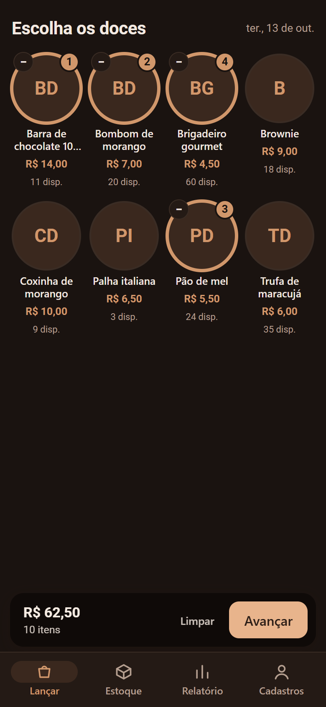
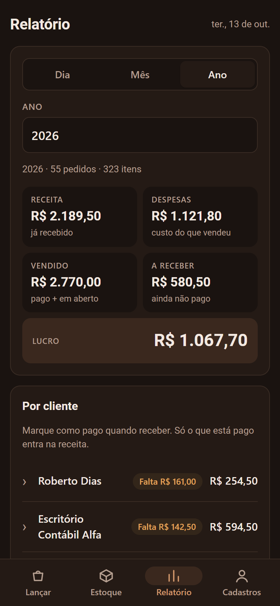
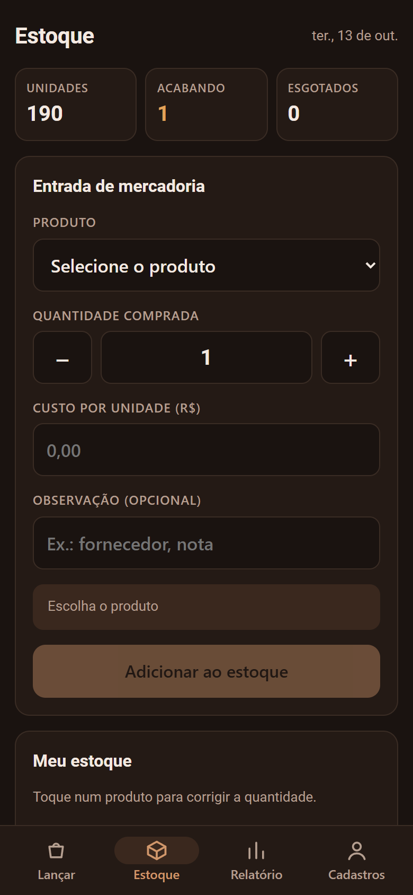
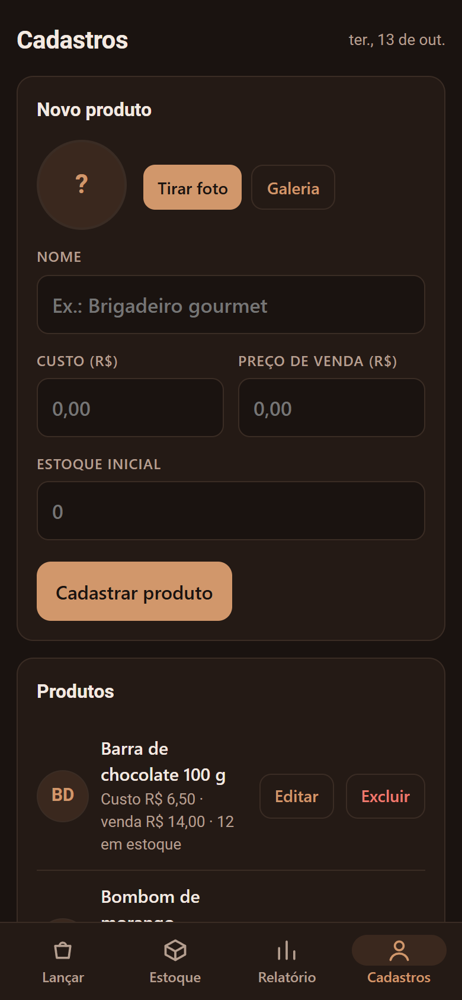

# Caderno de Pedidos

**App Android para quem vende doces sob encomenda: lança pedidos por cliente, controla o
estoque e cobra no fim do mês.** Em uso real por uma pequena vendedora de doces e chocolates,
com dois celulares compartilhando o mesmo estoque em tempo real.

Android (WebView) · JavaScript · Firebase Auth · Cloud Firestore · build sem Gradle

<p>
  
  
  
  
</p>

*Prints com dados fictícios, rodando no emulador do Firebase.*

## O problema

A venda era anotada num caderno de papel: quem pegou o quê, quanto custou, quem já pagou. No
fim do mês, a cobrança era refeita à mão e o estoque era conferido de olho. Com duas pessoas
vendendo, uma não sabia o que a outra já tinha vendido.

## O que o app faz

| | |
| :--- | :--- |
| **Lançar em três toques** | Vitrine de doces com foto (4 por linha), toque para pôr na cestinha, escolher o cliente, confirmar. O estoque baixa na hora. |
| **Estoque que não se perde** | Entrada de mercadoria com custo por unidade, ajuste por contagem, quebra ou consumo, histórico das movimentações e aviso de produto acabando. |
| **Cobrança no fim do mês** | Por cliente, três visões: **Total** (o que comprou no período), **Quitado** (o que pagou no período) e **Em aberto** (o que deve). Dívida que passa de um mês para o outro continua em aberto, separada por mês e marcada como "mês anterior". A cobrança sai pronta pelo WhatsApp. Aceita **pagamento parcial**, distribuído do pedido mais antigo para o mais novo, e o pagamento pode ser desfeito. |
| **Relatório por dia, mês ou ano** | Receita (o que foi recebido no período, pela data do pagamento), despesas (custo do que foi vendido), vendido, a receber (incluindo o que ficou de antes), lucro e os itens que mais saem. |
| **Vários celulares, um estoque** | Login por e-mail e senha. Os dados ficam no Firestore e aparecem nos outros celulares em tempo real. |
| **Funciona sem internet** | Os lançamentos são gravados no cache offline do Firestore e sobem quando a conexão volta. |
| **Backup** | Exporta tudo em JSON para a pasta Downloads e importa de volta, inclusive o formato da versão anterior, que guardava os dados só no celular. |

## Decisões técnicas

- **Estoque só muda por incremento.** Venda, entrada e ajuste gravam `FieldValue.increment`
  no Firestore, nunca "o novo valor". Duas vendas do mesmo doce em celulares diferentes, ao
  mesmo tempo, somam certo, mesmo que uma delas tenha sido feita offline.
- **Pedido e baixa de estoque no mesmo lote.** O pedido e o desconto de cada item vão num
  `batch` só: ou grava tudo, ou nada.
- **Quem protege os dados são as regras.** A configuração do Firebase não é segredo; as
  [regras do Firestore](firebase/firestore.rules.exemplo) liberam leitura e escrita apenas
  para os e-mails da lista.
- **Lê só o que a tela mostra.** O relatório consulta apenas os pedidos do período escolhido,
  para caber na cota gratuita do Firebase mesmo com anos de uso.
- **WebView servida como HTTPS.** O `MainActivity` intercepta as requisições e entrega os
  arquivos de `app/assets` em `https://appassets.androidplatform.net`. Sem isso, IndexedDB
  e o login do Firebase não funcionam dentro do app. A ponte `window.Android` cuida de câmera,
  galeria, backup em Downloads, compartilhar e links do WhatsApp.
- **Fotos leves.** A foto do produto é recortada no centro e reduzida para 320 px antes de ir
  para o banco.
- **APK sem Gradle.** O [`build.sh`](build.sh) monta o APK direto com as ferramentas do SDK:
  `aapt2` → `javac` → `d8` → `zipalign` → `apksigner`. O APK final tem cerca de 200 KB.

## Rodar e testar

**No navegador, com o emulador do Firebase** (sem conta no Firebase):

```bash
cd tools && npm install && npx firebase emulators:start --project demo-pedidos
```

```bash
node tools/servir.js
```

Abra <http://localhost:5055>. O `servir.js` troca a configuração do Firebase pela do emulador.

**Gerar o APK** (Android SDK com build-tools 36 e JDK 21):

1. Copie `app/assets/firebase-config.exemplo.js` para `firebase-config.js` e preencha com o seu projeto.
2. Copie `firebase/firestore.rules.exemplo` para `firestore.rules`, ponha os e-mails liberados e publique as regras.
3. Rode `./build.sh`. Na primeira vez, ele cria a chave de assinatura (`pedidos.keystore`), que fica fora do repositório.

## Estrutura

```
app/assets/index.html     o app inteiro: telas, regras e acesso ao Firestore
app/src/.../MainActivity  WebView, servidor HTTPS interno, câmera, backup e ponte com a página
firebase/                 regras do Firestore (exemplo)
tools/                    emulador do Firebase e servidor de teste
build.sh                  gera e assina o APK
```
